# FinSight AI

FinSight AI is a personal-finance dashboard. You import your bank or expense
transactions as a CSV, and it shows where your money goes: income against
spending month by month, spending by category, a forecast for next month with
an honest range, unusual transactions, and a health score you can see the
working for. Amounts are shown in rupees with Indian digit grouping
(₹1,25,000).

Built with Flask, pandas, scikit-learn and Plotly.js. Data is stored in SQLite
locally or Postgres in production. Fonts and the chart library are served by
the app itself, so pages make no requests to other sites.

## Screenshots

Real captures of the app with the bundled sample data, in both themes.

| Page | Desktop, light | Desktop, dark | Phone, light | Phone, dark |
| --- | --- | --- | --- | --- |
| Landing | [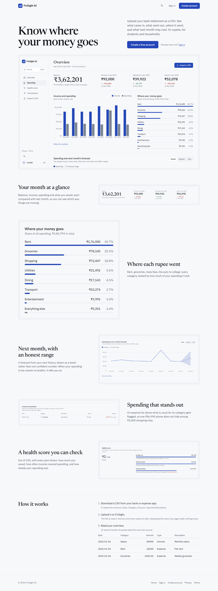](docs/screenshots/landing-1440-light.png) | [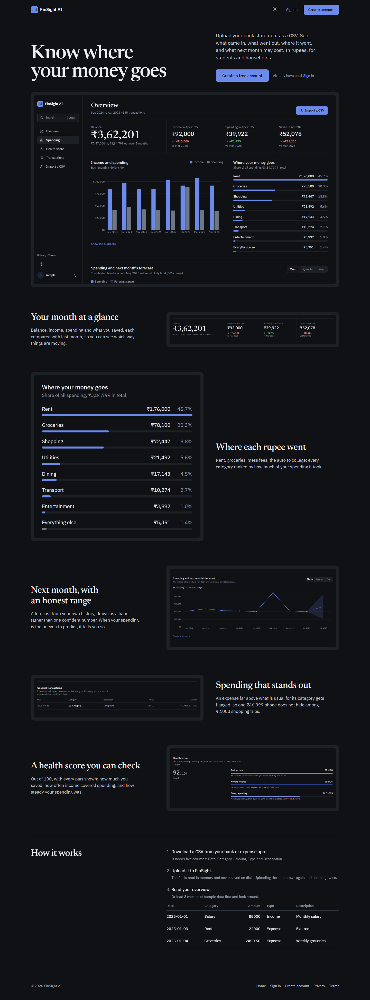](docs/screenshots/landing-1440-dark.png) | [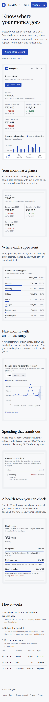](docs/screenshots/landing-390-light.png) | [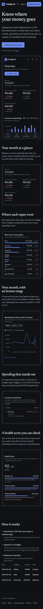](docs/screenshots/landing-390-dark.png) |
| Overview | [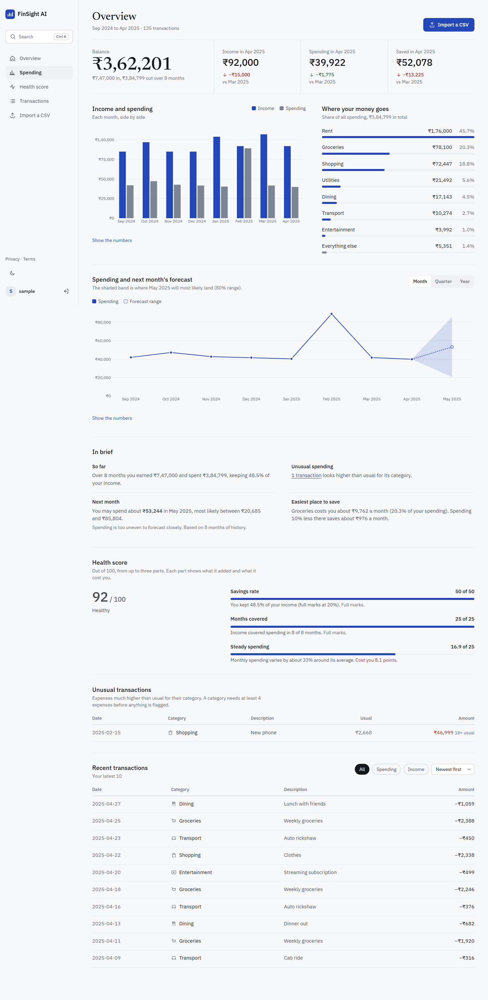](docs/screenshots/dashboard-1440-light.png) | [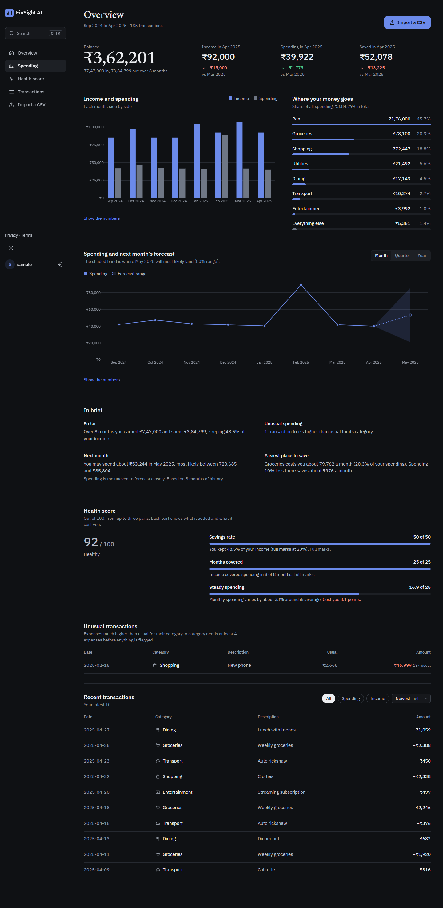](docs/screenshots/dashboard-1440-dark.png) | [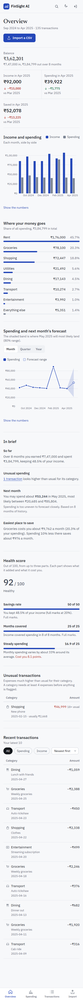](docs/screenshots/dashboard-390-light.png) | [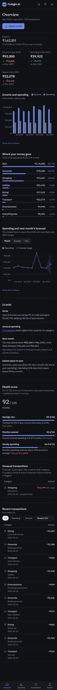](docs/screenshots/dashboard-390-dark.png) |
| Import | [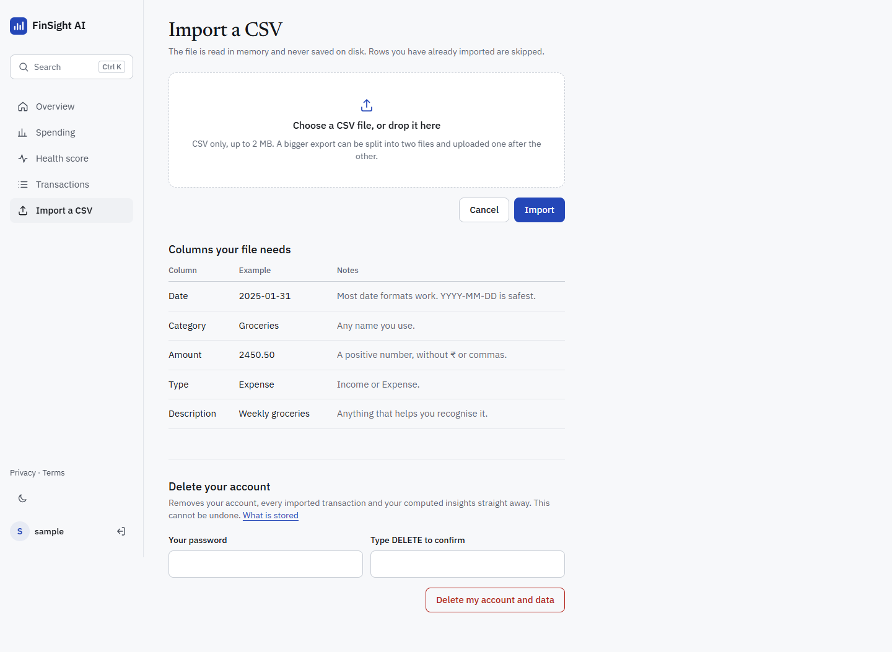](docs/screenshots/upload-1440-light.png) | [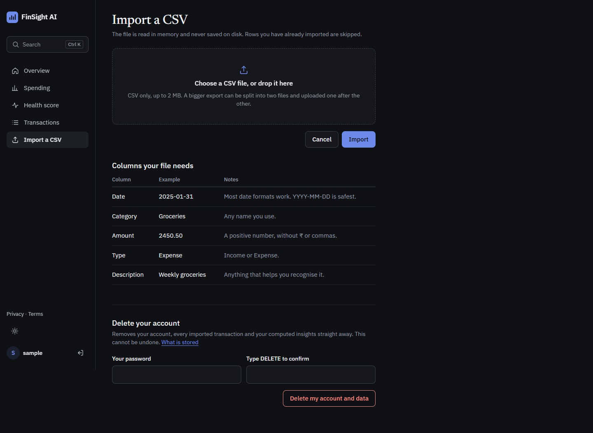](docs/screenshots/upload-1440-dark.png) | [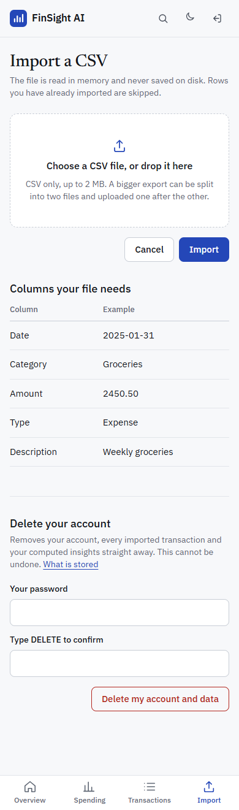](docs/screenshots/upload-390-light.png) | [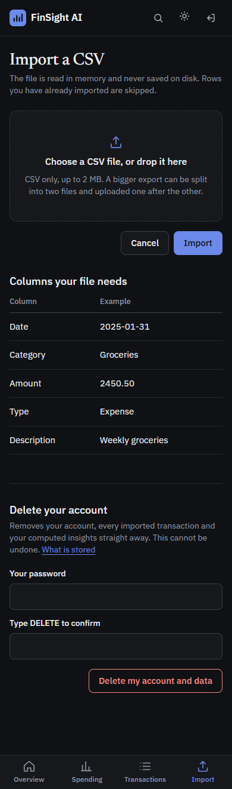](docs/screenshots/upload-390-dark.png) |

To refresh them (and the pictures on the landing page), see
[Screenshots](#regenerating-the-screenshots) below.

## Features

- Accounts with hashed passwords (12 characters minimum for new accounts),
  CSRF-protected forms and POST-only logout.
- **Delete your account** on the import page: removes the account, every
  transaction and the cached insights at once, after a password check.
- CSV import (parsed in memory, never stored on disk; 2 MB limit, with advice
  to split bigger files). Re-importing the same rows does not create duplicates.
- **Load sample data** on an empty overview: eight months of sample
  transactions loaded into your account only.
- Balance, plus this month's income, spending and savings, each compared with
  last month.
- Charts: income and spending per month, spending by category (the top seven
  and "Everything else", so shares add up to 100%), and spending over time with
  next month's 80% forecast range drawn as a band. Months are grouped by year
  and month ("Jan 2025"), so different years never merge.
- Unusual-transaction list (the newest 10, with a count of the rest).
- Financial health score with a breakdown of what each part added and cost.
- Plain-language [Privacy](templates/privacy.html) and
  [Terms](templates/terms.html) pages, linked from every footer.

## Run it locally

Requires Python 3.11+.

```bash
python -m venv .venv
# Windows: .venv\Scripts\activate    macOS/Linux: source .venv/bin/activate
pip install -r requirements-dev.txt

# Windows PowerShell: $env:FLASK_DEBUG="1"; python app.py
FLASK_DEBUG=1 python app.py
```

Open http://127.0.0.1:5000, create an account, then import a CSV or click
**Load sample data**.

Run the tests with:

```bash
python -m pytest
```

### Regenerating the screenshots

```bash
python scripts/screenshots.py
```

This starts the app on a throwaway database, signs up a sample user, loads the
sample data and saves `docs/screenshots/*.png` (landing, import and overview at
1440 and 390 px, light and dark) and the landing-page pictures in
`static/img/`. It needs the dev requirements (Playwright) and an installed
Google Chrome; nothing from the run is kept.

### Configuration

| Variable | Default | Purpose |
| --- | --- | --- |
| `SECRET_KEY` | random per run (local only) | Signs sessions. **Required in production**; the app refuses to start without it. |
| `ENVIRONMENT` | unset | Set to `production` to enable production checks. Render's `RENDER` variable does the same. |
| `DATABASE_PATH` | `instance/finsight_ai.db` | SQLite file used when `DATABASE_URL` is not set. |
| `DATABASE_URL` | unset | A `postgres://` / `postgresql://` URL switches storage to Postgres. |
| `FLASK_DEBUG` | unset | `1` turns on the debugger and auto-reload (local only). |
| `HOST` / `PORT` | `127.0.0.1` / `5000` | Where `python app.py` listens. It binds to `0.0.0.0` only in production without debug. |

## CSV format

One row per transaction, with a header row. Column names are case-insensitive.

| Column | Required | Example | Notes |
| --- | --- | --- | --- |
| `Date` | yes | `2025-01-31` | Any format pandas can parse; ISO dates are safest. |
| `Category` | yes | `Groceries` | Free text. Anomalies are judged within each category. |
| `Amount` | yes | `2450.50` | Positive number in rupees, no currency symbol or commas. |
| `Type` | yes | `Expense` | `Income` or `Expense`. Other values are skipped. |
| `Description` | yes | `Weekly groceries` | Free text. |

```csv
Date,Category,Amount,Type,Description
2025-01-01,Salary,85000,Income,Monthly salary
2025-01-03,Rent,22000,Expense,Flat rent
2025-01-04,Groceries,2450.50,Expense,Weekly groceries
```

Rows with an unreadable date, a missing or non-positive amount, or an unknown
type are dropped. Exact duplicates (same date, category, amount, type and
description) are imported once. `dataset/sample_transactions.csv` is a full
example.

## How the "AI" works

There is no deep learning here. The app uses small statistical models that you
can check by hand. They are computed once per user when data is imported and
cached in the database (`user_insights` table). No model files are written,
and nothing is shared between users.

**Spending forecast.** Expenses are totalled per calendar month; months with
no spending count as ₹0. A straight-line trend (scikit-learn
`LinearRegression`) is fitted to those totals and extended one month ahead.
The range is a standard 80% regression prediction interval: it comes from how
far past months sat from the trend line, so it is wide when spending is
erratic or history is short.

- Fewer than 3 months: no forecast, just "need at least 3 months of data".
- 3–5 months: forecast shown and labelled *low confidence*.
- 6 or more months: shown normally.

A straight line cannot know about festivals, one-off purchases or a pay rise,
and a single large purchase pulls the trend up. Treat the forecast as a rough
guide.

**Unusual transactions.** Each expense is compared with the median of its own
category, scaled by the median absolute deviation (MAD). This is the
"modified z-score"; an expense is flagged when it scores above 3.5, i.e. it is
much higher than usual. Lower-than-usual amounts are never flagged. If every
amount in a category is identical (rent, a fixed subscription), MAD is 0, and
an amount is flagged only if it is more than 50% above the usual one. Categories with fewer than 4 expenses are skipped
because there is no "usual" yet. Income is never flagged.

**Health score (0–100).** Calculated in one place, `ml/health_score.py`, and
shown with its breakdown on the dashboard:

| Part | Points | Full marks when |
| --- | --- | --- |
| Savings rate | 50 | you keep 20% or more of your income |
| Months covered | 25 | income covered spending in every month |
| Steady spending | 25 | monthly spending barely varies (needs 2+ months) |

If a part cannot be measured yet, the score is scaled to the parts that can.
With no income recorded there is no score; the dashboard asks you to add
income transactions instead. 80+ is "Healthy", 60–79 "Stable", below that
"Needs attention". The weights are a judgement call, not a financial standard.

**Tip.** The dashboard points at your largest *variable* expense category
(categories where every payment is identical, like rent, are skipped). It
shows what that category costs per month on average, and what a 10% cut
would save.

## Deploying on Render

1. Create a Web Service from this repo.
   - Build command: `pip install -r requirements.txt`
   - Start command: `gunicorn app:app`
2. Set `SECRET_KEY` to a long random value. Without it the service will not
   start.
3. **Use Postgres for data you want to keep.** Render's free web services have
   an ephemeral disk that is wiped on every deploy and restart, so a SQLite file
   there loses all accounts and transactions. Create a Postgres database (on
   Render or elsewhere) and set `DATABASE_URL` to its connection string. Tables
   are created automatically on start.

## Project structure

```
app.py               Application factory, CSRF, error handlers (404, 413)
config.py            Settings from environment variables
database.py          SQLite / Postgres connection and schema
models.py            Users, transactions, cached insights, account deletion
utils.py             CSV cleaning, dashboard numbers, chart specs, ₹ formatting
blueprints/          Routes (auth, overview, import, sample data, privacy, terms)
ml/                  Forecast, anomaly detection, health score
templates/           Pages (Jinja)
static/style.css     The design system: tokens first, then components
static/app.js        Theme, charts, filters, command palette
static/fonts/        Newsreader and IBM Plex Sans (OFL 1.1), self-hosted
static/vendor/       plotly-basic 2.27.0 (MIT), self-hosted
static/img/          Landing-page captures made by scripts/screenshots.py
scripts/             screenshots.py
docs/screenshots/    README screenshots
dataset/             Sample data (sample_transactions.csv)
tests/               pytest suite
```

## Design system

A calm, light-first look for a money app: one deep blue accent, large figures
in tabular numerals, and hairline rules between sections instead of boxed
cards. Light is the default; a dark theme is available from the sun/moon
button (saved in `localStorage` as `finsight-theme` and applied in `<head>`
before the first paint). All tokens are at the top of `static/style.css`;
change them there, not in components.

**Colour (light / dark).** Every text colour passes WCAG AA (4.5:1) on every
surface in both themes.

| Token | Light | Dark | Use |
| --- | --- | --- | --- |
| `--bg` | `#F7F8FA` | `#0F1114` | Page |
| `--surface` | `#FFFFFF` | `#16181C` | Auth card, palette, inputs |
| `--surface-2` | `#EFF1F4` | `#1D2025` | Active nav, hovered rows, chart placeholders, meter tracks |
| `--line` / `--line-strong` | `#E2E5EA` / `#C9CED6` | `#262A31` / `#3A4049` | Hairline dividers / control borders |
| `--ink` / `--ink-2` / `--muted` | `#14171C` / `#454C58` / `#5F6774` | `#ECEEF1` / `#B9BFC8` / `#939AA5` | Text / secondary text / labels |
| `--accent` | `#2447B8` | `#6B8AEA` | The one action colour, links, the main data series |
| `--good` / `--bad` | `#17703F` / `#B3261E` | `#4CC38A` / `#F28B82` | A change in your favour / against you, overspend, unusual amounts |
| `--chart-muted` | `#7C8594` | `#6F7785` | The second, quiet chart series |

Colour never carries meaning alone: changes have an arrow and a `+` or `−`
sign (a real minus, U+2212), and "bad" amounts are also named in words.

**Type.** Two families, both self-hosted (`static/fonts/`):

- **Newsreader 500** only for page headings (`.page-title`, 28–32 px) and the
  one hero balance (`.figure-hero`, 40–52 px). Landing headings use it too.
- **IBM Plex Sans 400–600** for everything else: body 16/24, labels and
  secondary text 14/20, section titles 18/24 medium, KPI figures 22–28 px.
  Every number uses `font-variant-numeric: tabular-nums` so columns line up.

Headings use `text-wrap: balance`. Nothing meant to be read is under 13 px.

**Shape.** A deliberate radius scale: `--r-xs` 4 px for tags and keyboard
hints, `--r-sm` 8 px for buttons, inputs and selects, `--r-md` 12 px for
floating panels (auth card, command palette) and screenshot frames, and
`--r-full` only for filter chips and the avatar. Spacing is a 4 px scale
(`--s1`…`--s24`). Shadows appear only on the command palette; everything at
rest is flat, separated by a tone step or a hairline.

**Layout.**

- **Signed out** (landing, sign in, register, privacy, terms, 404): a plain top
  bar (logo, theme, Sign in, Create account) and a footer with the year from the
  server clock.
- **Signed in:** a 232 px labelled sidebar on desktop. Under 900 px it is
  replaced by a top bar (search, theme, log out) and a fixed bottom tab bar
  (Overview, Spending, Transactions, Import) padded for the phone's safe areas.
- **Overview order:** title and period, KPI row (balance, then this month's
  income, spending and savings with the change from last month), income and
  spending beside where your money goes, spending with the forecast band, a
  short plain-language summary, health score, unusual transactions, recent
  transactions.

**Charts.** `utils.py` builds each chart as a JSON spec (data, ₹ hover text,
₹ axis ticks with Indian grouping); `static/app.js` draws it with plotly-basic
and styles it from the tokens: one accent series, a muted grey second series,
faint horizontal gridlines only, axes starting at ₹0, no legend box (an HTML
legend sits above the chart). Each chart frame keeps its final height and
shows a placeholder until it is drawn, a plain message if the script cannot
load, and a "Show the numbers" table as the text version. On phones only about
four month labels are shown. The category split is an HTML ranked bar list, not
a chart.

**Motion.** Little and short. Buttons press to 98% for 100 ms; colours change
over 150 ms; landing sections rise 16 px once as they scroll into view. Chart
placeholders pulse gently while loading; nothing else loops. Figures never count up
(money must never show a wrong number, even for a moment), and the command
palette opens instantly because it is a keyboard action.
`prefers-reduced-motion` keeps fades and drops all movement.

**Accessibility.** Every control shows a 2 px `:focus-visible` ring in the
accent colour; there is a skip link, icon buttons are labelled, the command
palette uses combobox/listbox roles, each chart has a table version, and the
category list is plain text.

**Touch.** Hover styles only apply with a mouse or trackpad; controls have no
tap flash or double-tap delay; on touch screens every control is at least
44 px and form fields are 16 px, so iOS does not zoom.

**Out of bounds for this design:** gradients, glows, glass or blur panels,
violet accents, icons in tinted squares, sparklines on KPIs, bento grids of
cards, pill labels above headings, tiny uppercase labels, emoji, and a second
accent colour.
